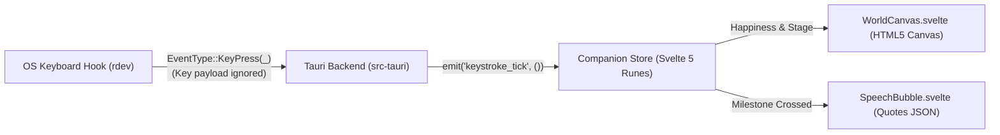

# Isfahan Architecture & Cross-Platform Development Guide

## Overview

Isfahan is a tiny, transparent desktop widget that lives in the corner of your screen. Every time you press a key while working, writing, or coding, your companion grows happier, its pixel-art garden evolves through stages (`Barren` → `Sprouting` → `Blooming` → `Flourishing` → `Persian Oasis`), and it occasionally shares timeless words of wisdom.

---

## 1. Privacy-First Global Keystroke Hook

Located in [`src-tauri/src/lib.rs`](../src-tauri/src/lib.rs):
- Uses the cross-platform `rdev` crate (`WH_KEYBOARD_LL` on Windows, `CGEventTap` on macOS).
- Matches `EventType::KeyPress(_)` with an ignored wildcard `_` and immediately emits `"keystroke_tick"` with `()` to the WebView.
- Zero network permissions and zero disk writes inside the hook thread ensure the binary stays clean for Windows Defender and macOS Gatekeeper.

---

## 2. Developing on macOS & Building for Windows

### macOS Accessibility Permission (Required for Global Keystrokes on Mac)
macOS requires explicit Accessibility permission for any process using `CGEventTap` (`rdev`):
1. Open **System Settings → Privacy & Security → Accessibility**.
2. Enable your terminal or IDE (e.g., **Terminal**, **iTerm2**, **Cursor**, **VS Code**, or **Antigravity**).
3. Restart the terminal and run `bun run tauri:dev`.
*(Tip: Even without Accessibility permissions, you can click the widget or type while focused on the preview during `bun run dev` to test all animations and quotes!)*

### Building for Windows (No Windows PC Required)
The repository includes [`.github/workflows/release.yml`](../.github/workflows/release.yml) powered by `tauri-apps/tauri-action`:
- Pushing a version tag (e.g., `git tag v0.1.0 && git push --tags`) or triggering the workflow manually via GitHub Actions (`workflow_dispatch`) spins up a `windows-latest` runner and a `macos-latest` runner.
- Produces standalone Windows `.msi` and `.exe` (NSIS) installers under 5 MB.

---

## 3. Adding Custom Pixel Art (itch.io Assets) & Quotes

Everything content-related is separated into `static/` so you or an AI assistant can expand the world without refactoring core logic:

| File | Purpose |
| :--- | :--- |
| [`static/data/quotes.json`](../static/data/quotes.json) | Pre-programmed quotes from books/texts, categorized by minimum happiness threshold. |
| [`static/data/world-stages.json`](../static/data/world-stages.json) | Defines happiness tiers (`0-100`), sky/ground palettes, and unlocked world props. |
| [`static/data/sprite-manifest.json`](../static/data/sprite-manifest.json) | Maps PNG spritesheets in `static/assets/` (frame width/height, row index, frame count). |
| [`static/assets/`](../static/assets/README.md) | Drop your `character.png` and `tileset.png` from itch.io here. |
